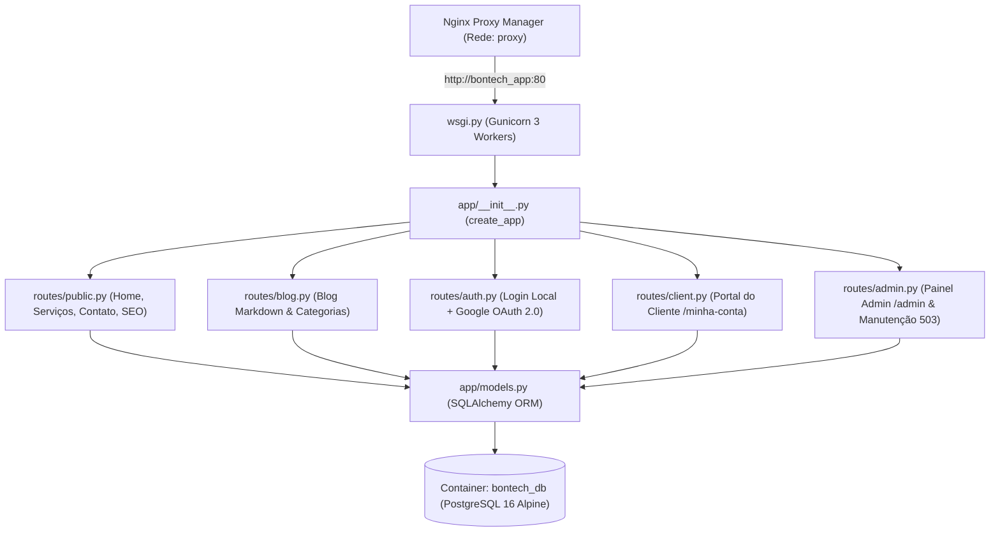

# 🏗️ Visão Geral da Estrutura & Código — Portal Bontech (`bontech.com.br`)

Este documento detalha a arquitetura, a estrutura de diretórios e o funcionamento de cada módulo do portal institucional, blog e painel administrativo da **Bontech TI & Governança**, desenvolvido em **Python (Flask)** + **PostgreSQL 16**.

---

## 🗺️ 1. Visão Geral da Arquitetura

O sistema utiliza o padrão **Application Factory + Blueprints** do Flask, com servidor de produção **Gunicorn** (3 workers) conectado ao **Nginx Proxy Manager** na rede externa `proxy` (`http://bontech_app:80`):



---

## 📂 2. Estrutura de Diretórios e Arquivos

```text
/home/andre/GitHub/bontech/
├── .github/workflows/
│   └── deploy.yml              # CI/CD: valida sintaxe Python e roda deploy.sh na VPS
├── app/
│   ├── __init__.py             # Inicializa Flask, Banco, OAuth, Seed e Modo Manutenção 503
│   ├── config.py               # Lê todas as variáveis do arquivo .env
│   ├── extensions.py           # Instâncias: SQLAlchemy, LoginManager, CSRF, OAuth, Limiter
│   ├── models.py               # Tabelas do PostgreSQL (User, Service, Category, Post, etc.)
│   ├── seed.py                 # Popula automaticamente os 6 serviços, artigos e usuário admin
│   ├── utils/
│   │   ├── mail.py             # Disparo de e-mail HTML (SMTP) em background + Webhook n8n
│   │   └── media.py            # Gerador de slugs e conversor automático de imagens p/ WebP
│   ├── routes/                 # Controladores divididos por módulo (Blueprints)
│   │   ├── public.py           # Rotas abertas: /, /servicos, /contato, /busca, /sitemap.xml
│   │   ├── blog.py             # Rotas do blog: /blog e /blog/<slug> (com Markdown)
│   │   ├── auth.py             # Autenticação: /auth/login, /auth/cadastro, /auth/google
│   │   ├── client.py           # Área do Cliente: /minha-conta (acompanhar solicitações)
│   │   └── admin.py            # Painel Admin: /admin (CRM, CMS Blog, Serviços, Manutenção)
│   ├── static/
│   │   ├── css/style.css       # Design System completo (Azul Marinho + Azul Royal Bontech)
│   │   ├── js/main.js          # Menu mobile e modal de pesquisa rápida
│   │   ├── img/                # Ícones e ilustrações vetoriais SVG dos serviços e blog
│   │   └── uploads/            # Volume Docker onde ficam as imagens enviadas pelo painel
│   └── templates/              # Páginas HTML com Jinja2 (herdam de base.html)
│       ├── base.html           # Cabeçalho duplo, Navbar, Modal de Busca e Rodapé Azul
│       ├── public/             # index.html, services.html, service_detail.html, contact.html...
│       ├── blog/               # index.html e detail.html
│       ├── auth/               # login.html, register.html, forgot_password.html...
│       ├── client/             # dashboard.html (Portal do Cliente)
│       └── admin/              # dashboard.html (Painel Administrativo em Abas)
├── Dockerfile                  # Imagem Python 3.12 Slim rodando Gunicorn na porta 80
├── docker-compose.yml          # Orquestra bontech_app + bontech_db na rede proxy
├── deploy.sh                   # Script de deploy sem intervenção manual
├── requirements.txt            # Pacotes Python instalados
├── DOCUMENTACAO.md             # Guia operacional e de configuração
├── PRD.md                      # Documento de requisitos do produto
├── VISAO_GERAL_ESTRUTURA.md    # Este documento de arquitetura e código
└── wsgi.py                     # Ponto de entrada da aplicação
```

---

## 🔍 3. Explicação Detalhada do Código por Camada

### 3.1. Inicialização, Proxy e Modo de Manutenção (`app/__init__.py`)
Na função `create_app()`:
- **`ProxyFix`:** Faz com que o Flask reconheça automaticamente o HTTPS e o IP real do visitante vindos do **Nginx Proxy Manager** (essencial para que o callback do Google OAuth gere URLs com `https://bontech.com.br`).
- **Criação e Seed Automático:** Ao iniciar o container, `db.create_all()` cria as tabelas no PostgreSQL caso não existam e chama `run_seed()` (`app/seed.py`) para popular os 6 serviços de TI, categorias, posts iniciais e a conta de administrador.
- **Modo de Manutenção 503 SEO-Friendly (`check_maintenance_mode`):** Antes de cada requisição, verifica se o modo de manutenção foi ativado no painel. Se estiver ativo:
  - Visitantes comuns e robôs do Google recebem a página `maintenance.html` com código **HTTP 503** e cabeçalho `Retry-After: 3600` (preservando o posicionamento no Google).
  - Administradores logados (`admin`) navegam normalmente pelo site inteiro com um banner de aviso no topo.

---

### 3.2. Modelagem do Banco de Dados PostgreSQL (`app/models.py`)
O banco `bontech_db` possui **6 tabelas principais**:
1. **`User`:** Guarda usuários tanto de login local (`password_hash` criptografado com Werkzeug) quanto de login via Google (`google_id`, `avatar_url`), além do papel (`role`: `'admin'` ou `'client'`) e token de recuperação de senha.
2. **`Service`:** Armazena os 6 serviços da Bontech (GLPi, Automação n8n, Gestão de Incidentes, Ativos/ITAM, Conhecimento/KCS e Central de Serviços), com título, slug para URL amigável, descrição curta, descrição completa, lista de entregáveis e benefícios.
3. **`Category` & `Post`:** Estruturam o Blog e a Base de Conhecimento, contando visualizações (`views`), tempo de leitura, tags e conteúdo em Markdown.
4. **`ConsultationRequest`:** É o coração do **Mini-CRM**. Toda vez que alguém preenche o formulário de contato ou abre um pedido na área do cliente, gera um protocolo único (ex.: `BNT-20261019-4821`), armazena o serviço desejado, o status (`Novo`, `Em Análise`, `Proposta Enviada`, `Em Andamento`, `Concluído`) e o parecer da equipe (`admin_response`).
5. **`Setting`:** Guarda os textos da Home, telefones, WhatsApp, e-mail, URL do Webhook do **n8n** e o estado do Modo de Manutenção para edição direta pelo painel sem necessidade de alterar código.

---

### 3.3. Rotas e Funcionalidades (Blueprints em `app/routes/`)

- **Páginas Públicas (`app/routes/public.py`):**
  - `GET /`: Renderiza a Home (`public/index.html`) com os cards de serviços, pilares de governança e últimos posts.
  - `GET /servicos` e `GET /servicos/<slug>`: Listagem e página individual de cada serviço com entregáveis, benefícios e botão direto para solicitar proposta daquele serviço.
  - `GET/POST /contato`: Formulário com proteção anti-bot (*Honeypot* + *Rate Limit* de 10 envios/minuto), que gera o protocolo, envia e-mail HTML para o cliente e para o administrador (`app/utils/mail.py`) e dispara o JSON para o **n8n** se houver webhook configurado.
  - `GET /busca?q=...`: Pesquisa *case-insensitive* (`ILIKE`) simultaneamente nos títulos/textos dos Serviços e nos artigos do Blog.
  - `GET /sitemap.xml` e `/robots.txt`: Gerados dinamicamente para indexação no Google.

- **Autenticação Híbrida (`app/routes/auth.py`):**
  - Suporta login tradicional (`/auth/login`), criação de conta (`/auth/cadastro`), recuperação de senha por token (`/auth/esqueci-senha`) e login com 1 clique pelo Google (`/auth/google` -> `/auth/google/callback`).
  - **Vínculo Automático (`_link_orphan_consultations`):** Se um visitante enviou uma mensagem no formulário de contato *antes* de ter conta e depois resolveu fazer login (local ou com Google) usando o mesmo e-mail, o sistema vincula automaticamente todas as solicitações anteriores dele à conta.

- **Portal do Cliente (`app/routes/client.py` — `/minha-conta`):**
  - Área exclusiva onde o cliente visualiza todos os seus protocolos de orçamento/consultoria, acompanha a mudança de status, abre novas solicitações e lê as respostas enviadas pela administração.

- **Painel Administrativo (`app/routes/admin.py` — `/admin`):**
  - Protegido pelo decorator `@admin_required`.
  - Organizado em 6 abas em `templates/admin/dashboard.html`:
    1. **Visão Geral:** Indicadores de leads, serviços, artigos, leituras e usuários.
    2. **Solicitações / CRM:** Permite mudar o status do chamado comercial, escrever a resposta (que já envia um e-mail automático ao cliente) ou clicar no botão **WhatsApp** para abrir conversa direta com o cliente.
    3. **Serviços:** Criar, editar ou excluir serviços e subir imagens de capa (convertidas automaticamente para **WebP** pela função `save_image_as_webp` em `app/utils/media.py`).
    4. **Blog & KCS:** Publicar artigos em Markdown, criar categorias e gerenciar publicações.
    5. **Usuários:** Visualizar quem se cadastrou (se veio por Login Local ou Google OAuth) e promover/alterar permissões.
    6. **Configurações & Manutenção 503:** Editar dados de contato do topo/rodapé, configurar a URL do Webhook do **n8n** e ligar/desligar o Modo de Manutenção com 1 clique.
